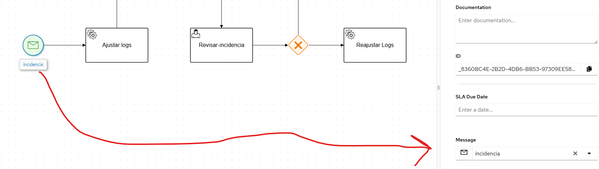

# Gestión de Eventos
El SOAR está organizado como una EDA que reacciona, o envía, eventos a un bróker de mensajes. Las pruebas se han hecho con kafka y la configuración inicial está realizada para kafka.
## Recepción de eventos en los procesos
Los procesos pueden incluir eventos de inicio o intermedios desde el bróker de mensajes. La configuración de eventos se realiza en application.properties del siguiente modo:
### Para configurar el servidor:

spring.kafka.bootstrap-servers=${KAFKA_BOOTSTRAP_SERVERS:localhost:9092}
### Para configurar el cliente consumidor del motor

```
spring.kafka.consumer.group-id=soar4fueba
spring.kafka.consumer.auto-offset-reset=earliest
```
### Para configurar los topics y los tipos de mensaje que se pueden usar en los procesos
Topics por defecto: kogito_incoming_stream (recepción) y kogito_outgoing_stream (envío).

Para asignar un topic concreto a cada mensaje BPMN (<NombreMensaje> = nombre del mensaje en el proceso):
```
kogito.addon.cloudevents.kafka.kogito_incoming_stream.<NombreMensaje>=<topic>
kogito.addon.cloudevents.kafka.kogito_outgoing_stream.<NombreMensaje>=<topic>
```
Por ejemplo
```
kogito.addon.cloudevents.kafka.kogito_incoming_stream.incidencia=soar-alertas
```
La configuración es por tipo de mensaje, de modo que se indica el topic en el que se recibirá ese tipo de mensaje, luego en el proceso los eventos se asocian a un tipo de mensaje.

Esto permite que en los procesos podamos hacer configuraciones como la mostrada en la figura

Donde se configura como evento de inicio de una instancia del proceso la recepción de un mensaje de tipo "incidencia"
## Configuración de kafka
La forma más fácil de arrancar y configurar kafka es usando docker-compose. El yaml proporcionado permite levantar el broker simplemente ejecutando docker compose up -d. La información completa sobre la imagen docker de kafka se encuentra en https://hub.docker.com/r/apache/kafka

Los test usan un kafka embebido y no es necesario levantarlo, pero si se necesita probar sin usar los tests será necesario arrancarlo para verificar el funcionamiento de la solución.

Una vez arrancado será necesario arrancar un terminal en el servidor para crear el topic:
```
docker exec --workdir /opt/kafka/bin/ -it brokerkafka sh
./kafka-topics.sh --bootstrap-server localhost:9092 --create --topic soar-alertas
```
Para enviar al bróker:
```
./kafka-console-producer.sh --bootstrap-server localhost:9092 --topic soar-alertas
```
Conecta un productor que se queda esperando mensajes de consola para enviarlos

También se puede hacer con los clientes en la máquina local windows.
Si se descarga kafka en la carpeta bin/windows se pueden encontrar scripts para crear productores y consumidores
Crear un productor
´´´
.\kafka-console-producer.bat --bootstrap-server localhost:9092 --topic soar-alertas
´´´
Los mensajes deben tener formato cloud events
´´´
{"specversion":"1.0","id":"prueba-1","source":"/consola","type":"incidencia","datacontenttype":"application/json","data":"Acceso sospechoso al servidor de pagos. TODO: Datos en formato ocsf"}
´´´


